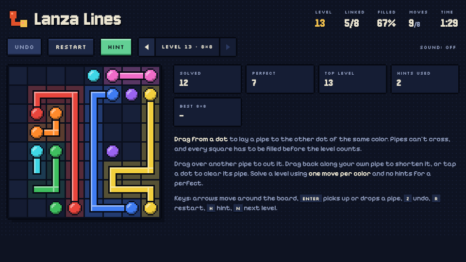

# Lanza Lines

A pixel-art pipe puzzle by Lanza Games. Play it at **https://lanza-games.netlify.app/lanza-lines**



## How to play

- Each color has two dots. **Drag from a dot** to lay a pipe to its partner.
- Pipes can't cross or branch, and the level only counts once **every square is filled**.
- Drag over another color's pipe to cut it. If you back off again during the same drag, the cut pipe grows back.
- Drag back along your own pipe to shorten it, or tap a dot to clear its pipe.
- **Hint** lays down one color's real route. Undo is unlimited and Restart clears the board (you can undo that too).

Keyboard: arrows move around the board, `Enter` picks up or drops a pipe, `Z` undoes, `R` restarts, `H` gives a hint, `N` goes to the next level once you've solved one.

### Levels

Every level is generated, and level 7 is the same puzzle for everyone. The board grows as you go:

| Levels | Board |
| --- | --- |
| 1-3 | 5×5 |
| 4-7 | 6×6 |
| 8-12 | 7×7 |
| 13-18 | 8×8 |
| 19-25 | 9×9 |
| 26-33 | 10×10 |
| 34-43 | 11×11 |
| 44 and up | 12×12 |

A **perfect** solve uses one move per color (a move is a drag with a different color than the last one) and no hints. Solving a level unlocks the next, and you can go back to any level you've reached.

Your current level, the pipes on the board, and your stats (solves, perfects, best time on each board size) save automatically in your browser's local storage.

## Run it locally

It's a single file with no dependencies besides Google Fonts. Open `index.html` in a browser, or:

```bash
python3 -m http.server 8000
```

## Code tour

All the code is in `index.html`:

- **COLORS / PIXEL SPRITES**: the 16 pipe colors, the dot sprite and the logo, drawn from small text grids with an outline added automatically.
- **LEVELS**: the puzzle generator. It builds a random path that visits every square (a snake shuffled with "backbite" moves), then cuts it into one piece per color. The ends of each piece become the dots, so every level has at least one solution that fills the board.
- **DRAWING PIPES**: dragging, cutting other pipes, and following fast swipes one square at a time.
- **ACTIONS**: undo, restart, hints and changing level.
- **BOARD**: rendering. Everything is drawn in art pixels (12 per square) scaled by a whole number, so the board stays crisp at any size.
- **INPUT**: pointer and keyboard controls.
